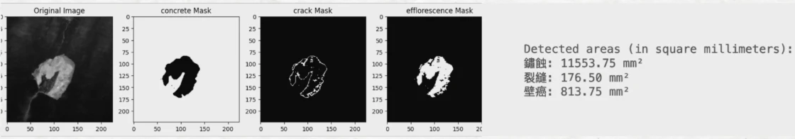

# WallGuard：牆面危害 AI 辨識系統

## 🎯 這是什麼

這是 DTAI 課程專題 WallGuard 的辨識模型原型，原名「牆牆出事」。上傳一張牆面照片，U-Net 模型會切出缺損區域並換算面積，再請 GPT 根據結果給出處理建議，全部在一份 Colab 筆記本裡完成。

專案曾受邀在 InnoFest@ICI 2024 展出，也參加了 2025 AI Award。

▶️ [Demo 影片（AI Award 2025）](https://www.youtube.com/watch?v=pVikml-YPsw)

## 💡 為什麼做

臺灣超過一半的房屋屋齡在 30 年以上，北部七成以上的住宅是需要共同決策的集合住宅。壁癌、裂縫、鋼筋外露處處可見，但多數人分不清它們的差別，也不知道該怎麼處理、該找誰，常常錯過處理的時機。我們想讓民眾拍一張照片，就能知道是什麼問題、大概多嚴重、下一步該做什麼。

## 🕹️ 怎麼用

1. 點上方的 **Open in Colab**。
2. 在「執行階段 → 變更執行階段類型」選 **T4 GPU**。
3. 在左側欄的 🔑 **Secrets** 新增 `OPENAI_API_KEY`，並開啟「筆記本存取權」。
4. 從第一格依序執行到最後一格：
   - 程式會從 [dtaidataset](https://github.com/Yunyuhu/dtaidataset) 下載約 190 MB 的訓練資料。
   - 訓練 5 個 epoch，T4 上約需 50 分鐘。
   - 最後一格會開啟 Gradio 介面，上傳牆面照片就能看到結果。

> 模型檔（約 120 MB）沒有放進這個 repo，每次執行都會重新訓練。

## 🛠️ 怎麼實作

| 步驟 | 做法 |
|---|---|
| 資料 | 3,000 張室內牆面照片，鏽蝕（混凝土剝落與鋼筋外露）、裂縫、壁癌各 1,000 張，來自 Roboflow Universe 的公開資料集 |
| 前處理 | 照片轉成灰階並縮放成 224×224；遮罩由 OpenCV 以灰階門檻 127 二值化產生 |
| 資料增強 | 水平翻轉、垂直翻轉、隨機旋轉（最多 90 度） |
| 模型 | U-Net：4 次「2 層卷積＋最大池化」擷取特徵，再以上採樣與跳接還原尺寸，最後輸出 3 個通道（約 3,100 萬個參數） |
| 訓練 | Adam（learning rate 1e-4），搭配 EarlyStopping、ModelCheckpoint、ReduceLROnPlateau；batch size 4，5 個 epoch |
| 面積換算 | 計算每個通道的像素數，乘上假設的像素尺寸（0.5 mm × 0.5 mm）換算成 mm² |
| 生成建議 | 把各類面積送給 `gpt-3.5-turbo`，請它列出簡短的處理建議 |
| 介面 | Gradio：上傳照片後顯示三張遮罩、各類面積與 AI 建議 |

訓練結果：驗證集準確率 90.42%、損失 0.124。

## 🙋 我負責什麼

我在 4 人團隊（DesignLens）裡負責資訊開發和專案管理（PM）。這份筆記本由我和一位隊友共同撰寫。

## 📍 完成到哪

這是課程專題的原型，可以完整跑完訓練並開啟介面。回頭檢視程式，有以下限制：

- **遮罩其實只分出明暗：** 遮罩是用灰階門檻把照片轉成黑白，再把像素值壓進 3 個類別，過程中沒有用到照片原本的類別。因此標籤幾乎只剩「暗」和「亮」兩種，三個輸出通道對應的是明暗，而不是三種牆損。
  - 上圖中，鏽蝕（concrete）通道幾乎涵蓋整片較暗的背景，壁癌（efflorescence）通道是亮的區域，裂縫（crack）通道則落在明暗交界。
  - 90.42% 的準確率反映的是模型重現這個門檻的程度。
- **驗證集只有壁癌：** 照片依類別排序後直接取前 80% 訓練，所以驗證集的 600 張全是壁癌照片。
- **損失函數不搭：** 輸出層是三類 softmax，損失函數卻用 `binary_crossentropy`。
- **面積不是真實尺寸：** 像素尺寸是假設值，沒有依拍攝距離校正。
- **GPT 模型：** `gpt-3.5-turbo` 之後可能停用，屆時需要改成新的模型名稱。

下一步：

- 改用人工標註或內含遮罩的公開資料集，讓三個通道真正對應三種牆損。
- 打散資料後再切分，讓三類都出現在驗證集。
- 以 RAG 提升建議內容的精準度，減少幻覺。

## 🔗 去哪看成果

- [Demo 影片（AI Award 2025）](https://www.youtube.com/watch?v=pVikml-YPsw)
- [作品集網站的專案頁](https://yunyu-web-digital-profile.vercel.app/projects/wallguard)：使用者研究、功能設計與完整流程
- [訓練資料集 dtaidataset](https://github.com/Yunyuhu/dtaidataset)：資料來自 Roboflow Universe 上的公開資料集（包含 DeepCrack、CRACK500 等），授權依各原始資料集為準
